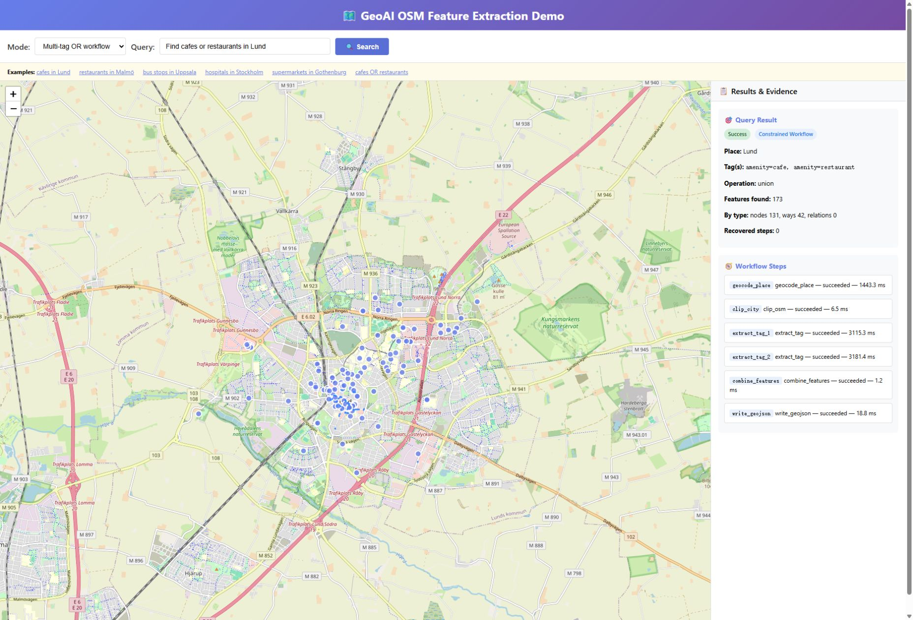
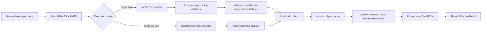

# GeoAI OSM RAG Agent

A local-first, evidence-grounded geospatial agent that converts natural-language requests into validated OpenStreetMap queries and interactive GeoJSON maps. [Stage 2](#stage-2-geoanalyst-extension-m00m12a) extends it into a bounded spatial-analysis agent over population, public-transport and POI data, evaluated on a versioned benchmark with a sealed private split.

## Highlights

**Stage 2 (M00–M12a)**

- Typed GeoDSL task contracts, a versioned dataset registry, and six allow-listed vector GIS tools with CRS, tolerance and resource limits.
- A 205-tag English/Chinese OSM knowledge base: hybrid Recall@1 0.966 and MRR 0.980 on 205 public, catalog-informed queries.
- Constrained planner with clarification, strict result validation, one bounded replan, multi-turn session edits and evidence-backed HTML reports.
- Versioned benchmark: 160 public tasks plus sealed private splits, strict scoring on Feature IDs, geometry, numbers and tool sequence; the validator configuration passes 136/160 public and 34/48 sealed-private tasks under strict scoring ([caveats](#stage-2-geoanalyst-extension-m00m12a)).
- 565/565 offline tests pass locally; 24 ADRs record the design decisions, and evaluation protocols were frozen before implementation from M07 on.

**Stage 1 (P1–P5)**

- Hybrid information retrieval: MiniLM/FAISS dense search, BM25 lexical search, tag-level deduplication, and reciprocal-rank fusion.
- Guarded LLM decisions: local Qwen structured parsing, strict schema and grounding checks, and deterministic fallback.
- Deterministic geospatial execution: Nominatim bounding boxes, `osmium` clipping, `pyosmium` geometry extraction, and provenance-rich GeoJSON.
- Constrained multi-tag workflows: allow-listed tools, explicit step state, bounded retry, cache reuse, timings, and trace IDs.
- Measured internal results: hybrid Recall@1 improved from 82.5% to 100% on a 63-query project-authored benchmark.
- Real workflow evidence: a Lund café-or-restaurant query produced 173 deduplicated objects with 6/6 successful tool steps.

> All reported retrieval and workflow numbers come from small, project-authored internal datasets or recorded local runs. They are not external benchmarks or production guarantees.



## System Architecture



The probabilistic decision layer is separated from deterministic spatial execution. Unknown tools, unsupported plan shapes, invalid tags, and ungrounded model outputs are rejected before they reach the OSM pipeline. See [the architecture notes](docs/ARCHITECTURE.md) for interfaces and failure paths.

## Results

Stage 1 results are below; Stage 2 results are in the [next section](#stage-2-geoanalyst-extension-m00m12a).

| Evaluation | Result | Evidence |
|---|---:|---|
| Dense retrieval, 63 internal queries | Recall@1 82.5%; MRR 0.8854 | `benchmarks/results/p1_baseline.*` |
| Final hybrid retrieval, same 63 queries | Recall@1 100%; MRR 1.0 | `benchmarks/results/p3_hybrid_baseline.*` |
| Local Qwen final decision, 21 internal queries | 85.7% | `benchmarks/results/p3_llm.*` |
| Constrained planning, 12 internal queries | 12/12 exact plans | `benchmarks/results/p4_workflow.*` |
| Lund café + restaurant workflow | 173 deduplicated objects; 6/6 steps succeeded | `benchmarks/results/p4_workflow.*` |
| Offline regression suite (Stage 1 + Stage 2) | 565/565 passed locally | `tests/` |

The 100% retrieval result does not imply 100% end-to-end semantic accuracy: the separate 21-query local-Qwen evaluation reached 85.7%. This distinction is intentional and retained in the repository evidence.

## Stage 2: GeoAnalyst extension (M00–M12a)

Stage 1 (P1–P5, above) answers single-place OSM tag queries. Stage 2 turns the project into a bounded spatial-analysis agent: typed task contracts, a versioned dataset registry, deterministic vector GIS tools, population and public-transport data, a constrained planner with validation and one bounded replan, multi-turn sessions, evidence-backed reports, and a versioned benchmark with a sealed private split. Evaluation protocols for M07–M12a were frozen before their implementation ([`docs/roadmap/`](docs/roadmap/README.md)), and design decisions are recorded as [ADRs](docs/adr/). Six of the frozen protocols were written in Chinese and are hash-locked as evidence, so they are kept byte for byte with an English translation next to each.

| Module | What it adds | Measured result (internal) |
|---|---|---|
| M01–M02 | GeoDSL task contracts; local dataset registry (GeoJSON/CSV, checksums, lifecycle) | 65 GeoDSL fixtures; contract tests |
| M03 | OSM knowledge base v3: 205 canonical tags, 410 English/Chinese documents from 203 pinned official pages; dense, BM25 and hybrid indexes | Hybrid on 205 public queries: Recall@1 0.966, Recall@5 0.995, MRR 0.980 |
| M04 | Six allow-listed vector tools (`filter_attributes`, `buffer_features`, `nearest_features`, `features_within`, `spatial_join`, `aggregate_by_region`) with CRS, tolerance and resource limits | Fixed four-step chain, failure abort and reproducibility verified |
| M05 | SCB 2025 1 km population grid adapter (CC0) with disclosure-control semantics | Conservative lower-bound aggregation |
| M06 | GTFS Sverige 2 ingestion, service-day windows, stop/route frequency, EPSG:3006 stop buffers | Stop-service coverage; no full routing or isochrones |
| M07 | Constrained command grammar → GeoDSL plan, clarification, strict JSON static gate, plan preview API/UI | 80/80 legal plans, exact tool sequences and exact parameters (v2) |
| M08 | Result validator, explicit repair/substitution, one bounded replan, 24 tool-call cap | 16 fault cases: recovered 4/4, classified 12/12, guarded rejection 8/8 |
| M09 | Bounded session state: distance, exclusion, city-source and count-comparison edits with verified step reuse | 16 multi-turn cases, four metrics 100% |
| M10 | `AnalysisResult` v1.0 with SVG layers, charts, report and download ([demo](docs/demo/m10_analysis_result_v2.html)) | 12/12 on four evidence/presentation metrics |
| M11 | Benchmark v2.0: 160 public dev tasks + 40 private tasks, strict scorer (Feature IDs, geometry IoU/Hausdorff, numeric tolerance, tool sequence) | See comparison below |
| M12a | Lund school-coverage-gap scenario on SCB grid + OSM schools ([demo](docs/demo/m12a_school_coverage_gaps_v1.html)) | 13/13 frozen cases; identical receipts across two runs |

**Baseline comparison (M11c).** Three configurations receive the same task text and dataset catalogue: a fixed workflow (FW-A), the dynamic planner (M07), and the planner with validator and replan (M07 + M08). Strict pass = every scored field correct.

| Split | Front end | Fixed workflow | Dynamic planner | + Validator/replan |
|---|---|---:|---:|---:|
| Public dev (160) | rule-based (v1) | 8 | 16 | 136 |
| Public dev (160) | local qwen2.5:3b semantic frame (v2) | 8 | 16 | 136 |
| Sealed private v2 (48) | local qwen2.5:3b semantic frame (v2) | 6 | 12 | 34 |

The rule-based v1 front end parsed none of the 40 private v1 queries (0/40 for all systems); this failure motivated the v2 model front end, which was frozen in three stages before the sealed private set was run once. Only 5 private tasks are executable by all three systems (strict 0 / 0 / 5). Excluding the required-steps check, the dynamic planner and the validator configuration score the same (public dev 136 vs 136, private v2 34 vs 34), so the strict gap reflects the validation steps the benchmark requires rather than different answers. Buffer-only tasks stay in the denominator as failures and ranking is unsupported. Details: [`benchmarks/README.md`](benchmarks/README.md) and `benchmarks/results/m11c_v2/M11C_V2_FINAL_REPORT.md`.

> All Stage 2 numbers come from project-authored, mostly synthetic datasets and frozen local runs. M03 public queries are catalog-informed rather than independently labelled, and the M12a references come from an independent oracle written by the same author. They demonstrate contracts, reproducibility and failure analysis, not external generalization.

## Quick Start

The verified local path uses Windows, Miniconda/Anaconda, Ollama, Python 3.10, and roughly 6–8 GB of free disk space. The local Qwen model also requires enough RAM for a 3B-parameter model.

```bat
git clone https://github.com/xi2618zh-s/geoai-osm-rag-agent.git
cd geoai-osm-rag-agent

scripts\setup_env.cmd
conda run -n geoai_project_env python scripts\fetch_osm_data.py
ollama pull qwen2.5:3b
scripts\run_local.cmd
```

Open <http://127.0.0.1:8000/ui>.

The entrypoints use `conda run`, so they do not depend on shell activation. The data script downloads the Sweden PBF from Geofabrik, verifies the provider checksum, and writes a local receipt. The PBF and generated outputs remain untracked.

### API examples

Single-tag RAG and local-LLM query:

```http
POST /chat
Content-Type: application/json

{"query": "Find all cafes in Lund"}
```

Constrained multi-tag workflow:

```http
POST /workflow
Content-Type: application/json

{"mode": "natural_language", "query": "Find cafes or restaurants in Lund"}
```

Deterministic spatial debugging without an LLM:

```http
POST /chat_simple
Content-Type: application/json

{"place": "Lund", "key": "amenity", "value": "cafe"}
```

## Repository Structure

```text
src/rag/          dense, lexical, and hybrid retrieval
src/query/        structured LLM parsing and grounding validation
src/osm/          geocoding, PBF clipping, and geometry extraction
src/agent/        plans, planner, validator, sessions, front ends, result reports
src/geodsl/       typed GeoDSL task contracts (Stage 2)
src/datasets/     versioned local dataset registry (Stage 2)
src/knowledge/    205-tag OSM knowledge base build and retrieval (Stage 2)
src/tools/        allow-listed vector GIS, population and accessibility tools (Stage 2)
src/population/   SCB 1 km population grid adapter (Stage 2)
src/gtfs/         GTFS Sverige 2 ingestion (Stage 2)
src/evaluation/   benchmark contracts, strict scorers and comparison runners (Stage 2)
src/scenarios/    scenario layer, e.g. Lund school coverage gaps (Stage 2)
benchmarks/       versioned internal datasets, runners, and result artifacts
data/fixtures/    small versioned fixtures with manifests (licence recorded for external data)
tests/            offline contracts, geometry, reliability, retrieval, and delivery
scripts/          data download, builds, reproducibility audits, Windows entrypoints
docs/             architecture, deployment, demo, and benchmark documentation
docs/adr/         architecture decision records
docs/roadmap/     evaluation protocols, freezes, data/tool catalogs (see its README)
docs/demo/        standalone HTML result demos
```

## Methodology

The Stage 1 knowledge base contains 21 OSM Wiki tag pages split into 144 cleaned chunks (Stage 2 adds the separate 205-tag v3 knowledge base). Dense and lexical rankings are deduplicated at the OSM tag level and fused before the local model sees supporting evidence. The model must emit a strict structured decision; validation either accepts a grounded tag or selects a deterministic ranked fallback.

For spatial execution, the system resolves a place through Nominatim, clips the country PBF once, extracts nodes, ways, and relations with `pyosmium`, deduplicates objects, and writes a unique GeoJSON artifact. Multi-tag natural-language support is deliberately limited to explicit English OR requests; API callers can also request object-identity intersection.

## Evaluation

The repository keeps datasets, configurations, runners, summaries, and machine-readable results together. The 63-query retrieval set covers 21 labels with canonical, paraphrased, and contrastive phrasing. A separate 21-query challenge set informed the final fusion weight, so it is treated as validation rather than a blind holdout.

Run the offline suite and reproducibility audit:

```bat
scripts\test_offline.cmd
conda run -n geoai_project_env python scripts\check_reproducibility.py --ci
```

Re-run the final retrieval configuration:

```bat
conda run -n geoai_project_env python -m benchmarks.run_benchmark --retriever-mode hybrid
```

See [benchmark methodology](docs/BENCHMARKS.md) and [`benchmarks/README.md`](benchmarks/README.md) for the full evaluation contract. Each Stage 2 module has its own runner and byte-for-byte reproducibility audit (`scripts/audit_m*_reproducibility.py`); their commands and frozen result paths are listed in `benchmarks/README.md`.

## Reproducibility

- `environment.yml` pins Python 3.10 and declares the external `osmium-tool` dependency.
- `requirements.txt` constrains Python packages by compatible version ranges.
- `scripts/fetch_osm_data.py` streams, checks, and atomically installs the external PBF.
- `.github/workflows/ci.yml` defines an offline Linux test job; its status should be judged from GitHub Actions after publication.
- Network services, the first embedding-model download, Ollama, and the large PBF are intentionally excluded from offline CI.

## Limitations

- Evaluation sets are small and project-authored; Stage 2 tasks are mostly synthetic, and M03 public queries are catalog-informed.
- Stage 1 natural-language multi-tag planning supports explicit English OR only; intersection means object-identity intersection.
- Stage 2 planning is a restricted command grammar (or a local 3B model emitting a semantic frame) over six allow-listed tools: no arbitrary tool calling, open-ended autonomous planning, multi-agent system, or long-term memory.
- Ranking tasks are unsupported; transit analysis uses stop buffers and service frequency, not routing or travel-time isochrones.
- Scenarios m12b/m12c, robustness work (M13) and final packaging (M14) are not yet implemented.
- Nominatim and OSM data change over time, so feature counts are snapshots.
- The Flask service is a local engineering demo, not a hardened public deployment.

## License

No open-source license has been selected. The repository is currently available for viewing and evaluation only; normal copyright rules apply.
