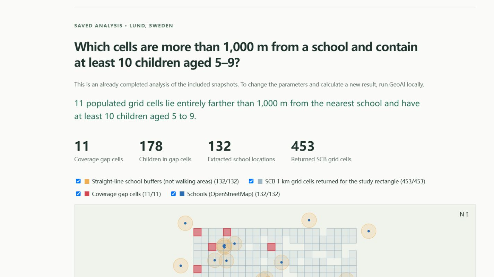
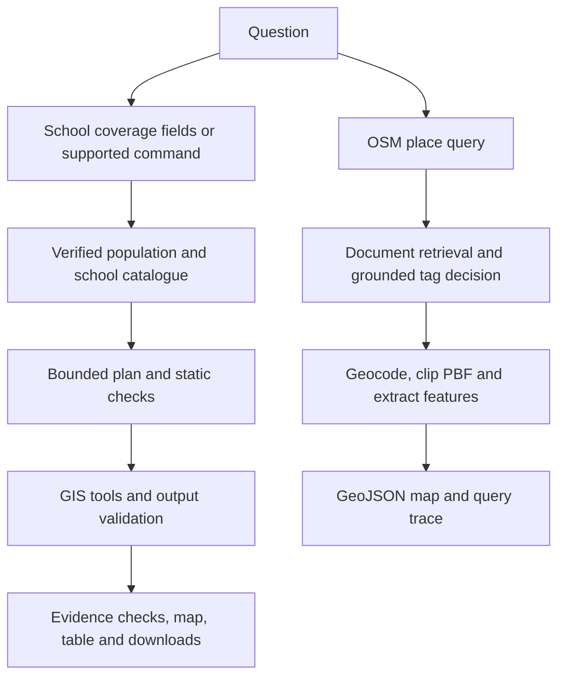

# GeoAI

[](https://github.com/xi2618zh-s/geoai-osm-rag-agent/actions/workflows/ci.yml)

GeoAI helps you find places in OpenStreetMap and analyse nearby services with population data. It shows a map, the data and calculation steps behind the result, and a downloadable report.

**[View the school analysis](https://xi2618zh-s.github.io/geoai-osm-rag-agent/)** · [Run a new analysis](docs/LOCAL_DEMO.md) · [Implementation and evaluation](docs/ARCHITECTURE.md)



The website displays a saved analysis. To change the parameters and calculate a new result, run the local page below.

## An example analysis

Which populated grid cells around Lund are more than 1 km from an extracted school and contain at least 10 children aged 5–9?

The saved analysis finds **11 grid cells containing 178 reported children** in this age band. It uses 453 SCB population grid cells and 132 extracted OSM school points. Toggle layers, inspect features, read the matching rows and download the complete result as CSV or GeoJSON. The [original analysis record](benchmarks/results/m12/m12a/formal_v1/scenario_report_m12a_A1.json) and [frozen case report](benchmarks/results/m12/m12a/formal_v1/report.md) retain the evidence.

The calculation standardises population fields, projects school coordinates into metres and selects schools. It draws school buffers for display, measures each grid polygon to its nearest school point, then filters by distance and children in the selected band. Every output is checked before the report is built; report numbers are rebuilt from execution evidence before publication.

This answers a bounded question about the included snapshots. Distance is straight-line polygon-to-point distance, not a walk from a home to a school. Whole cells must lie beyond the threshold. Edge cells are included, so these totals are not Lund municipality's population. Distances above 2,000 m are upper bounds. School capacity, type and OSM completeness are unknown; different OSM representations of one school may remain separate.

The population reference date is 2025-12-31. The OSM file records a header timestamp of 2025-12-14; its original provider was not verified.

## How it works



Semantic interpretation and deterministic spatial execution have separate responsibilities. The school page uses explicit fields and the existing restricted command grammar; it does not call a language model or search the OSM knowledge base. Preview checks data and plan without invoking GIS analysis. Running reconstructs the plan on the server, executes allow-listed tools in an isolated registry and validates geometry, coordinate systems and metric evidence.

The separate OSM query path combines documented tag retrieval with a local structured model decision, then extracts real features from a PBF. Population and public-transport adapters, six vector tools, model-fronted planning and bounded session edits also exist in the library. They are documented in the [architecture](docs/ARCHITECTURE.md) and [implementation notes](docs/roadmap/README.md); the school page exposes only the included Lund scenario. Transit analysis uses stop buffers and service frequency, not routing.

## Run it locally

Use Python 3.10 or newer. Clone the repository and install the school dependencies into a virtual environment:

```powershell
git clone https://github.com/xi2618zh-s/geoai-osm-rag-agent.git
cd geoai-osm-rag-agent
python -m venv .venv
.venv\Scripts\python -m pip install -r requirements-demo.txt
.venv\Scripts\python scripts/run_demo.py
```

Open [the local analysis page](http://127.0.0.1:8000/explore). Choose a distance above zero and at most 2,000 m, an age band (`0-4`, `5-9`, `10-14`, `15-19`) and a minimum child count of at least one. Preview, run and download the report. No PBF, embeddings, Ollama, model download or external data request is needed. The public snapshots are included. See [installation, API, retention and troubleshooting](docs/LOCAL_DEMO.md).

To view only the saved website, using Python's standard library:

```powershell
python scripts/build_public_demo.py
python -m http.server 8080 --bind 127.0.0.1 --directory build/public_demo
```

Open [the saved analysis](http://127.0.0.1:8080/). The build uses an explicit file list and records source hashes. [Demo walkthrough](docs/DEMO.md) explains both experiences.

For live OSM queries, the [full environment instructions](docs/LOCAL_DEMO.md#osm-place-queries) use Conda, Ollama and the Sweden PBF. That path retains `/ui`, `/chat`, `/chat_simple`, `/workflow`, `/plan-preview`, `/plan-ui` and `/analysis-ui`. `/analysis-ui` displays a saved report; `/plan-preview` previews a plan.

## Evaluation and limits

| Evidence | Recorded result | What it measures |
|---|---|---|
| [Bilingual retrieval](benchmarks/results/m03/public_eval/m03_phase2_public_eval_v1/hybrid_metrics.json) | Recall@1 0.966; MRR 0.980 | 205 public, catalogue-informed internal queries |
| [School scenario](benchmarks/results/m12/m12a/formal_v1/report.md) | 13/13 frozen public cases | Scenario contracts, failure handling and reproducibility |
| [Spatial planner comparison](benchmarks/results/m11c_v2/M11C_V2_FINAL_REPORT.md) | 136/160 public; 34/48 sealed private | Strict scoring of results **and required steps** |

These are small project-authored evaluations. The school oracle is a separate implementation by the same author, not independent external labelling. Strict planner scores are not a validator-driven gain in answer accuracy: excluding the required-steps check, the dynamic planner and validation configuration score identically. The formal comparison did not trigger replanning. Recovery evidence comes from separate fault-injection tests, within their tested scope. Complex spatial relations remain a weakness; the full comparison records error analysis and scoring limits for aggregation.

Regression and reproducibility commands are in [the local guide](docs/LOCAL_DEMO.md#verification). Checkout acceptance results are recorded in [the verification record](docs/VERIFICATION.md), preserving archived experiments. Offline CI and Pages deployment serve different purposes: website deployment does not establish passing business tests.

## Development and credits

The [case study](PORTFOLIO_CASE_STUDY.md) describes the inherited prototype, documented choices and evidence. Design decisions are preserved in [ADRs](docs/adr/), with frozen protocols and original results linked from [benchmark documentation](benchmarks/README.md).

Code is under the [MIT License](LICENSE). Data keeps its own licence: SCB population and Trafiklab/Samtrafiken GTFS fixtures use CC0 1.0; OSM point fixtures use ODbL 1.0, © OpenStreetMap contributors; OSM Wiki text and derived knowledge use CC BY-SA 2.0 with attribution in the knowledge directories. Synthetic fixtures and authored tasks use their recorded CC0 terms. External PBF and model downloads retain their providers' terms.
