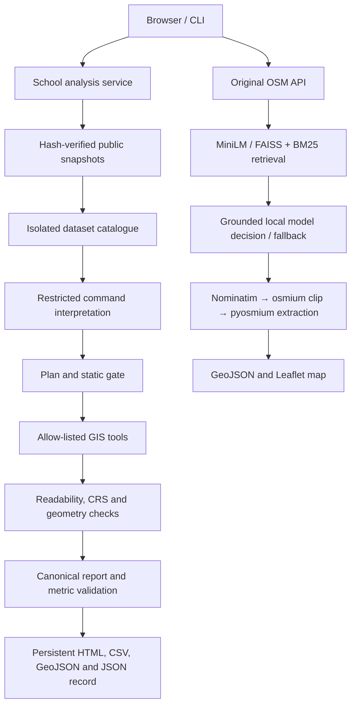

# GeoAI architecture

GeoAI supports place queries and bounded spatial analysis. The primary browser example compares Lund population cells with school locations. These paths use different inputs; the school scenario never calls the OSM tag retriever.

`src/web/analysis_data.py` pins both public manifests, checks their file hashes and builds the standard `ScenarioCatalogue`. It imports no oracle or evaluation code. `analysis_service.py` converts fields into the existing grammar, calls `interpret_m12a` and `plan_m12a`, then reuses `execute_scenario_plan`, `build_m12a_report`, `validate_m12a_report` and the standalone renderer unchanged.

Preview registers and verifies files temporarily but invokes no analysis tools. Run reconstructs the plan from request fields; client plans, paths and dataset IDs are rejected. Each request receives an opaque UUID directory. Reports and exports are written after evidence validation; `result.json` marks completion after the temporary registry is removed. Downloads are allowlisted and hash checked. Loading completed runs needs no in-memory session, so restart retains reports.

`analysis_routes.py` is a Blueprint mounted by the small demo app and `app_min.py`. The small app avoids the legacy model/PBF import tree, binds to loopback and accepts same-origin JSON. Clarification, unsupported, success and failure are distinct states. It is not deployed as a public backend.

`site/index.html` and plain CSS/JavaScript are shared by saved and local experiences. The static builder wraps the archived report JSON, decodes verified downloads and copies historical HTML byte for byte. An explicit file list and source manifest bound publishing output. SVG displays native EPSG:3006 metres with a legend and north indicator, without a web basemap. Projected exports need reprojection for RFC 7946 consumers.

The original OSM interfaces remain `/chat`, `/chat_simple`, `/workflow` and `/ui`. `/plan-preview` and `/plan-ui` remain previews; `/analysis-ui` remains a saved report. Use the [OSM setup](LOCAL_DEMO.md#osm-place-queries) for that app. The lightweight server exposes school analysis and saved-page preview only.

Population semantics, GTFS stop/service analysis, six GIS tools, model frames, validation and bounded session edits retain their individual contracts in [implementation notes](roadmap/README.md), [ADRs](adr/) and [benchmarks](../benchmarks/README.md). They are not all exposed in the school form.

The [formal comparison](../benchmarks/results/m11c_v2/M11C_V2_FINAL_REPORT.md) scores specified validation steps as well as results. Its strict-score gap is not an answer-accuracy improvement; no formal run triggered replanning. Separate fault tests establish bounded recovery. The adapters preserve frozen scenario, data and evaluation bytes, checked against the implementation protection baseline.
